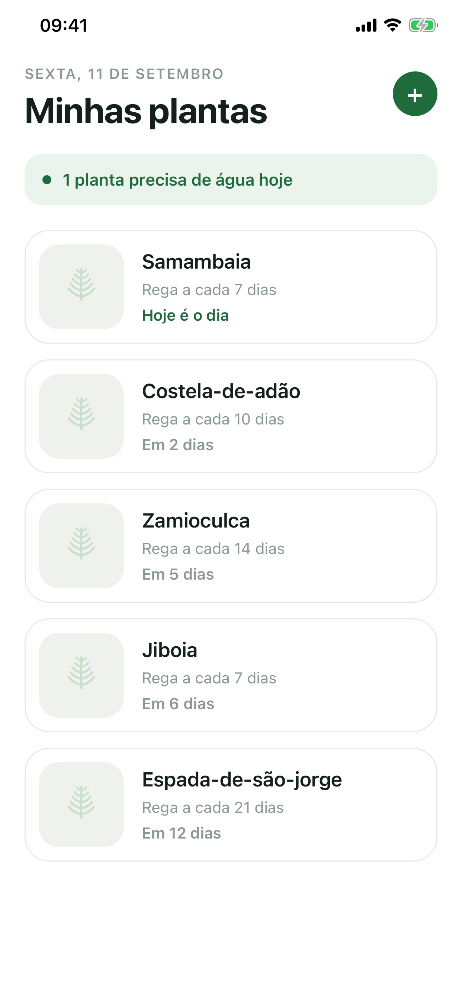
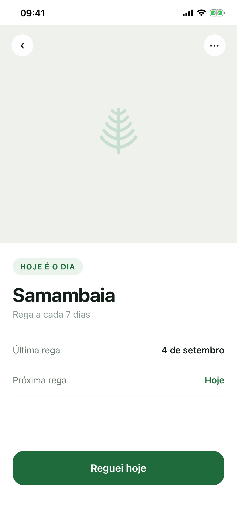
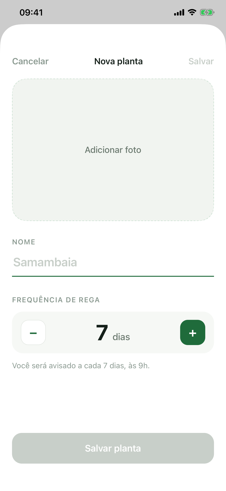

# Samambaia

App de celular que lembra quais plantas de casa já foram regadas e quais ainda não.

<p>
  
  
  
</p>

## Principais funcionalidades

- Lista de plantas ordenada da mais urgente para a menos urgente, com foto, nome e quantos dias faltam para a próxima rega.
- Cadastro com foto (câmera ou galeria, opcional), nome e frequência de rega em dias.
- Botão "Reguei hoje", que registra a rega e recalcula a próxima.
- Notificação local às 9h do dia em que a planta precisa de água.
- Plantas atrasadas destacadas ("Atrasada há 3 dias").
- Editar e excluir planta.
- Sem login, sem conta, sem nuvem: tudo fica num banco SQLite no próprio aparelho. Gratuito, sem compras dentro do app.

## Stack técnica

- TypeScript, React Native 0.83, React 19.2, Expo SDK 55 (um código só para iOS e Android)
- Expo Router (navegação), expo-sqlite (banco local), expo-notifications (lembretes locais)
- expo-image-picker, expo-image e expo-file-system (fotos), react-native-svg (ícone da samambaia desenhado no app)
- Config plugins próprios (`plugins/`) para assinatura iOS/Android e notificações só locais
- EAS Build para os builds de loja

## Como foi construído

O app foi desenvolvido com Claude (Anthropic). O repositório não traz uma spec SDD; o que existe para orientar e conferir o trabalho é:

- [`CLAUDE.md`](CLAUDE.md) / [`AGENTS.md`](AGENTS.md) com as notas para o agente de código: versão do SDK fixada de propósito, armadilhas do ambiente e convenções (datas como `YYYY-MM-DD` local, toda alteração passando por `src/store/plants.tsx`).
- `.claude/settings.json` habilitando o plugin oficial do Expo para o Claude Code.
- O mockup de telas feito no Claude Design, em [`telas-do-app-samambaia/`](telas-do-app-samambaia/), de onde saíram paleta e medidas.
- Checagem de tipos (`tsc --noEmit`), lint (ESLint) e `expo-doctor`. Não há testes automatizados.

## Status

Em desenvolvimento.

## Como rodar

Os módulos nativos (SQLite, câmera, notificações, SVG) não rodam no Expo Go: é preciso um build de desenvolvimento.

```bash
npm install
```

iOS (o CocoaPods exige locale UTF-8):

```bash
npx expo prebuild --platform ios --clean && (cd ios && LANG=en_US.UTF-8 pod install) && npx expo run:ios
```

Android (precisa do JDK 17 disponível para o Gradle):

```bash
npx expo prebuild --platform android --clean && npx expo run:android
```

Verificações:

```bash
npm run typecheck && npm run lint && npx expo-doctor
```

O build de release Android lê um `keystore.properties` não versionado na raiz do repositório; sem ele, o release é assinado com a chave de debug.

### Regras de negócio

- Ao cadastrar, a próxima rega é hoje + a frequência escolhida.
- Ao tocar em "Reguei hoje", a última rega passa a ser hoje e a próxima é recalculada.
- Ao mudar a frequência, a próxima rega é recontada a partir da última rega, ou do dia do cadastro para a planta que nunca foi regada.
- São agendados vários ciclos de aviso por planta (até 8, respeitando o teto de notificações do iOS), para quem não abre o app continuar recebendo avisos.
- A permissão de notificação é pedida ao salvar a primeira planta.

As datas são guardadas como data de calendário local (`YYYY-MM-DD`), nunca como timestamp, para "faltam 2 dias" continuar certo perto da meia-noite ou depois de mudar de fuso (`src/lib/dates.ts`).

### Estrutura

```
src/
  app/          telas (expo-router: index, nova, planta/[id], editar/[id])
  components/   peças visuais reaproveitadas entre telas
  db/           SQLite: conexão com migrações e o repositório de plantas
  lib/          datas, fotos, notificações, status de rega, action sheet
  store/        estado compartilhado que mantém banco e notificações em sincronia
  theme/        cores e medidas tiradas do mockup
```

`src/store/plants.tsx` é o único ponto por onde passam as alterações: toda mutação relê o banco (a fonte da verdade) e refaz os agendamentos, para a lista e as notificações nunca divergirem.

Ideias decididas e ainda não implementadas ficam em [`BACKLOG.md`](BACKLOG.md).

## Licença

O código está disponível apenas para leitura e estudo. Veja [LICENSE](LICENSE).

## Contribuições

Issues são bem-vindas; pull requests não são aceitos. Veja [CONTRIBUTING.md](CONTRIBUTING.md).

---

Feito pela [Dab Lab](https://www.dablab.com.br/) — product studio de software e IA que constrói apps para pequenas empresas, startups e áreas dentro de grandes empresas, partindo de uma especificação (Spec-Driven Development) e com as disciplinas de engenharia de software robusta.
